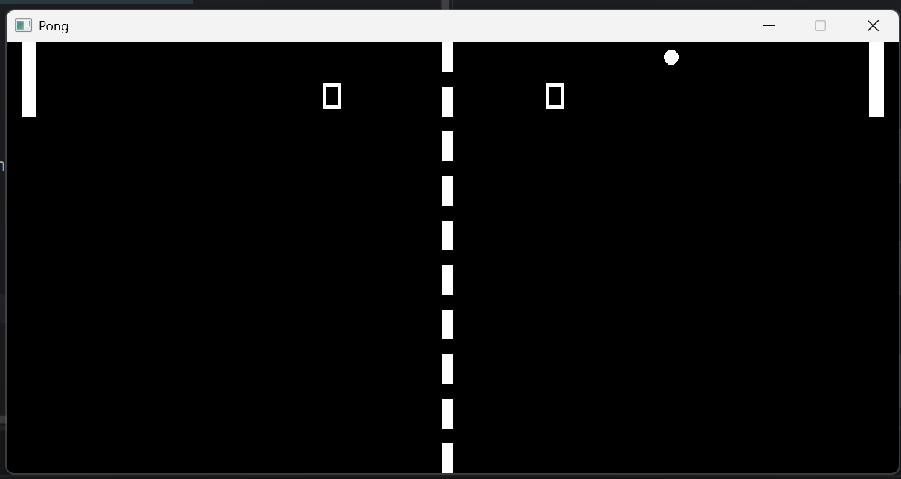

# Raylib Pong

this repository contains an implementation of the famous pong game (hello world equivalent in game development :) ) using
[Golang](https://go.dev/) and [Raylib](https://www.raylib.com/index.html).

## Perquisites

- golang 1.25.12
- make

## How to run

clone the repos using git:
```shell
git clone https://github.com/lazyboy81/Raylib-Pong.git
```
then go into the repo directory:
```shell
cd ./Raylib-Pong
```
And finally run the following to lunch the game:
```shell
make run
```

## The game loop


the ball moves in a random direction and players can use:
`W/S` and `↑/↓` to control the left and right paddles respectively